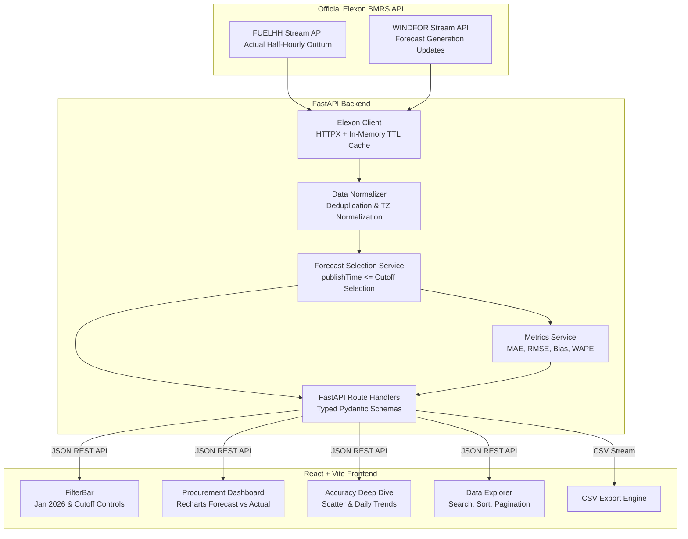

# WindScope UK — Day-Ahead Wind Forecast Analytics

> **"See the wind generation forecast available at decision time. Measure its error against actual generation. Make better-informed procurement decisions."**

[](backend/tests/)
[](frontend/src/tests/)
[](https://fastapi.tiangolo.com)
[](https://react.dev)
[](https://vitejs.dev)
[](docker-compose.yml)

---

## 1. Product Overview & Business Context

UK electricity utilities procure wholesale power in day-ahead auctions to serve consumer demand. Renewable wind generation is highly weather-dependent; procurement teams must balance customer commitments against forecasts that fluctuate across successive weather model runs.

When wind generation is **overforecast**, utilities under-procure thermal or dispatchable capacity and are forced to buy expensive real-time balancing energy from the system operator. When wind generation is **underforecast**, utilities over-contract energy, resulting in costly spill or distress sales.

### The Core Questions Answered
1. **What wind generation was forecast for each half-hourly delivery interval, using *only* forecasts available by the selected decision cutoff?**
2. **How accurate were those forecasts compared with the subsequently recorded actual generation?**

WindScope UK eliminates **lookahead bias** by strictly enforcing an as-of decision cutoff $C$. It reconstructs the exact historical decision frontier that was available to trading and procurement desks at gate closure.

---

## 2. Key Features

- **Procurement Overview Dashboard:** 48 half-hourly settlement intervals for January 2026, comparing eligible forecast curves against actual generation outturns in Megawatts (MW).
- **As-Of Decision Cutoff Selection:** Configurable cutoff date and time with prominent UK local time formatting (`GMT`), automatically excluding all subsequent updates.
- **Quantitative Forecast Accuracy:** Live calculation of **MAE**, **RMSE**, **Mean Forecast Bias**, and **WAPE** on matched intervals.
- **Zero-Denominator Safe WAPE:** Rigorous handling of calm weather conditions without division-by-zero exceptions.
- **Visual Analytics:**
  - Half-hourly Forecast vs. Actual Generation line chart.
  - Interval-by-interval Forecast Error bar chart (overforecast vs. underforecast).
  - Actual vs. Forecast scatter plot with a 45-degree parity reference line ($y = x$).
  - Daily MAE and RMSE tracking across all 31 days of January 2026.
- **Settlement Interval Data Explorer:** Searchable, sortable, paginated audit table with status indicators (`MATCHED`, `FORECAST_UNAVAILABLE`, `ACTUAL_UNAVAILABLE`, `DATA_UNAVAILABLE`).
- **CSV Data Export:** Single-click download of all 48 intervals with consistent ISO 8601 UTC and UK local timestamps.
- **Data Integrity Guarantee:** Missing intervals are never disguised or filled with artificial zeros.

---

## 3. Architecture Overview



---

## 4. Official Elexon Datasets & Normalization

Data is sourced directly from the official **Elexon Insights Solution (BMRS)** APIs:

### 1. Actual Generation: `FUELHH`
- **Official Documentation:** [BMRS FUELHH Stream](https://bmrs.elexon.co.uk/api-documentation/endpoint/datasets/FUELHH/stream)
- **Endpoint:** `/datasets/FUELHH/stream?settlementDateFrom={date}&settlementDateTo={date}&fuelType=WIND`
- **Fields:**
  - `startTime`: ISO 8601 timestamp of interval start.
  - `generation`: Actual outturn generation in Megawatts (MW).
  - `fuelType`: Strictly filtered to `WIND`.
  - `settlementPeriod`: Half-hourly period index (1 to 48).

### 2. Forecast Generation: `WINDFOR`
- **Official Documentation:** [BMRS WINDFOR Stream](https://bmrs.elexon.co.uk/api-documentation/endpoint/datasets/WINDFOR/stream)
- **Endpoint:** `/datasets/WINDFOR/stream?publishDateTimeFrom={start}&publishDateTimeTo={end}`
- **Fields:**
  - `startTime`: Target delivery interval start timestamp.
  - `publishTime`: Timestamp when the forecast update was published to market participants.
  - `generation`: Forecast wind power in Megawatts (MW).

### Timezone & Deduplication Policy
- All timestamps are parsed into **timezone-aware UTC datetimes** and formatted to UK local time (`Europe/London`). In January 2026, UK local time is GMT (UTC+0).
- If identical `(startTime, publishTime)` records occur, duplicates are collapsed deterministically. If conflicting generation values exist, a data quality warning is surfaced and the first deterministic record is preserved.

---

## 5. Critical Business Logic: As-Of Decision Cutoff Selection

The core analytical algorithm is implemented in [`backend/app/services/forecast_service.py`](backend/app/services/forecast_service.py):

For a target delivery interval with start time $T$, a user-configured decision cutoff $C$, and a candidate set of forecast records with publication timestamps $P$:

$$\text{selected\_forecast}(T, C) = \arg\max_{P} \{ F \mid F.\text{startTime} = T \land F.\text{publishTime} \le C \}$$

1. **Strict Exclusion:** Any forecast published after the cutoff ($P > C$) is strictly excluded, regardless of retrieval time.
2. **Arg Max Selection:** Among all eligible records published at or before the cutoff ($P \le C$), the system selects the record with the latest publication timestamp.
3. **Explicit Unavailability:** If no forecast was published prior to cutoff, the interval returns `status = FORECAST_UNAVAILABLE`. Missing values are **never converted to zero**.
4. **Lead Time Calculation:**
   $$\text{Lead Time (hours)} = \frac{T - P}{3600}$$
   Calculated strictly between interval start and forecast publication.

---

## 6. Quantitative Accuracy Metric Formulations

Implemented in [`backend/app/services/metrics.py`](backend/app/services/metrics.py) on matched interval pairs:

### Mean Absolute Error (MAE)
$$\text{MAE} = \frac{1}{N} \sum_{i=1}^{N} |\text{Forecast}_i - \text{Actual}_i| \quad (\text{MW})$$

### Root Mean Squared Error (RMSE)
$$\text{RMSE} = \sqrt{\frac{1}{N} \sum_{i=1}^{N} (\text{Forecast}_i - \text{Actual}_i)^2} \quad (\text{MW})$$
*Heavily penalizes extreme forecast errors that cause expensive grid imbalance charges.*

### Mean Forecast Bias
$$\text{Bias} = \frac{1}{N} \sum_{i=1}^{N} (\text{Forecast}_i - \text{Actual}_i) \quad (\text{MW})$$
- $\text{Bias} > 0$: Systematic **overforecasting** (utility contracted excess power).
- $\text{Bias} < 0$: Systematic **underforecasting** (utility contracted insufficient power).

### Weighted Absolute Percentage Error (WAPE)
$$\text{WAPE} = 100 \times \frac{\sum_{i=1}^{N} |\text{Forecast}_i - \text{Actual}_i|}{\sum_{i=1}^{N} \text{Actual}_i} \quad (\%)$$
- **Zero-Denominator Guard:** If $\sum \text{Actual}_i = 0$ (e.g. calm wind conditions across the evaluation window), WAPE returns `null` with the explicit note: *"WAPE is undefined because total actual generation in the evaluation period is zero."* It never divides by zero or manufactures a fabricated percentage.

---

## 7. Project Structure

```
Gridbricks/
├── backend/
│   ├── app/
│   │   ├── api/
│   │   │   └── routes.py            # Typed FastAPI endpoints
│   │   ├── services/
│   │   │   ├── elexon_client.py     # Elexon BMRS API client + TTL caching
│   │   │   ├── data_normalizer.py   # Validation & deterministic deduplication
│   │   │   ├── forecast_service.py  # As-of cutoff forecast selection engine
│   │   │   └── metrics.py           # MAE, RMSE, Bias, and WAPE calculations
│   │   ├── utils/
│   │   │   └── timestamps.py        # Timezone-aware UTC & UK local time helpers
│   │   ├── config.py                # Pydantic BaseSettings & constants
│   │   ├── main.py                  # FastAPI app entry point & CORS
│   │   └── schemas.py               # Strict Pydantic response models
│   ├── tests/
│   │   ├── test_api.py              # Endpoint integration tests
│   │   ├── test_elexon_client.py    # Mocking & caching tests
│   │   ├── test_forecast_selection.py # As-of cutoff boundary & logic tests
│   │   ├── test_metrics.py          # Mathematical formula & WAPE zero-division tests
│   │   └── test_timestamps.py       # Timezone & 48-interval tests
│   ├── Dockerfile                   # Multi-stage Python 3.11 image
│   ├── .dockerignore
│   └── requirements.txt
│
├── frontend/
│   ├── src/
│   │   ├── components/
│   │   │   ├── Header.jsx           # Application header with live status
│   │   │   ├── FilterBar.jsx        # Jan 2026 date & cutoff selector
│   │   │   ├── MetricCard.jsx       # KPI card with unit badges and tooltips
│   │   │   ├── GenerationChart.jsx  # Recharts 48-period Forecast vs Actual
│   │   │   ├── ErrorChart.jsx       # Recharts Error distribution
│   │   │   ├── ScatterChart.jsx     # Recharts Actual vs Forecast scatter
│   │   │   ├── DailyAccuracyChart.jsx # Daily MAE/RMSE bar/line chart
│   │   │   ├── DataTable.jsx        # Searchable, sortable, paginated explorer
│   │   │   └── MethodologyModal.jsx # Analytical methodology explanations
│   │   ├── pages/
│   │   │   ├── Dashboard.jsx        # Feature A: Procurement Overview
│   │   │   ├── AccuracyAnalysis.jsx # Feature B: Forecast Accuracy Analysis
│   │   │   └── DataExplorer.jsx     # Feature C: Data Explorer & CSV Export
│   │   ├── services/
│   │   │   └── api.js               # Client API integration
│   │   ├── styles/
│   │   │   ├── index.css            # Design tokens & dark enterprise theme
│   │   │   └── components.css       # Layout, table, modal, and button styles
│   │   ├── tests/
│   │   │   ├── App.test.jsx
│   │   │   ├── DataTable.test.jsx
│   │   │   ├── FilterBar.test.jsx
│   │   │   ├── MetricCard.test.jsx
│   │   │   └── setup.js             # Vitest jsdom & ResizeObserver mock
│   │   ├── App.jsx
│   │   ├── main.jsx
│   │   └── index.html
│   ├── Dockerfile                   # Multi-stage Node builder + Nginx Alpine
│   ├── nginx.conf                   # Nginx reverse proxy & SPA router
│   ├── package.json
│   ├── vite.config.js
│   └── vercel.json
│
├── docs/
│   ├── demo-script.md               # 2x 5-min presentation scripts (Customer & Tech)
│   └── submission-checklist.md      # Deliverable links & verification checklist
├── docker-compose.yml               # Single command multi-container setup
├── .env.example
├── .gitignore
└── README.md
```

---

## 8. Local Setup & Execution

### Prerequisites
- Python 3.11+
- Node.js 20+ & npm 10+
- Docker & Docker Compose (optional, for containerized run)

### Method A: Docker Compose (Recommended)
Start the entire platform with a single command:
```bash
docker compose up --build
```
- **Frontend:** `http://localhost:3000`
- **Backend API:** `http://localhost:8000`
- **API Documentation:** `http://localhost:8000/docs`

---

### Method B: Manual Local Development

#### 1. Backend Setup
```bash
# Navigate to backend directory
cd backend

# Create and activate virtual environment (optional)
python -m venv .venv
source .venv/bin/activate  # On Windows: .venv\Scripts\activate

# Install dependencies
pip install -r requirements.txt

# Run backend development server
uvicorn app.main:app --host 0.0.0.0 --port 8000 --reload
```

#### 2. Frontend Setup
```bash
# Open a new terminal and navigate to frontend directory
cd frontend

# Install dependencies
npm install

# Start Vite development server
npm run dev
```
Open `http://localhost:5173` in your browser.

---

## 9. Running Automated Test Suites

### Backend Tests (pytest)
```bash
# From workspace root
$env:PYTHONPATH="backend"; python -m pytest backend/tests -v
```
**Results:** **31 / 31 passed** in ~12 seconds.
- `test_forecast_selection.py`: 9 passed (arg max selection, cutoff exclusion, duplicate handling, 1-second boundary).
- `test_metrics.py`: 6 passed (known sample verification, bias direction, null WAPE on zero actual, unmatched exclusions).
- `test_timestamps.py`: 6 passed (UTC normalization, UK local GMT formatting, 48 intervals generation).
- `test_elexon_client.py`: 4 passed (HTTP mocks, fuelType WIND filter, offline fallback, TTL cache).
- `test_api.py`: 6 passed (endpoints health, Jan 2026 validation, 400 on out-of-bounds dates, CSV export).

### Frontend Tests (Vitest & React Testing Library)
```bash
# From frontend directory
cd frontend
npm test
```
**Results:** **4 / 4 test files passed (6 / 6 tests)** in ~7.5 seconds.
- `MetricCard.test.jsx`: Value rendering, null preservation without converting to zero.
- `FilterBar.test.jsx`: Date picker mutations, apply button, CSV export trigger.
- `DataTable.test.jsx`: 48 settlement intervals, status badges, missing data presentation.
- `App.test.jsx`: Tab navigation, methodology modal opening and closing.

---

## 10. API Documentation

| Method | Endpoint | Description | Query Parameters |
| :--- | :--- | :--- | :--- |
| `GET` | `/api/health` | Service health & data scope | None |
| `GET` | `/api/delivery-dates` | Supported January 2026 dates | None |
| `GET` | `/api/forecast` | Half-hourly selected forecasts vs actuals | `delivery_date`, `decision_cutoff` |
| `GET` | `/api/accuracy` | Overall MAE, RMSE, Bias, and WAPE | `start_date`, `end_date`, `cutoff_hour_utc` |
| `GET` | `/api/accuracy/daily`| Daily accuracy breakdown across January | `start_date`, `end_date`, `cutoff_hour_utc` |
| `GET` | `/api/data-status` | Elexon stream connectivity & cache metrics | None |
| `GET` | `/api/export` | CSV export of 48 settlement intervals | `delivery_date`, `decision_cutoff` |

Full interactive OpenAPI documentation is available locally at `http://localhost:8000/docs`.

---

## 11. Vercel Deployment

### Deploying the Frontend
The frontend is configured with `frontend/vercel.json` for client-side routing:
```bash
cd frontend
vercel --prod
```
Set the environment variable:
`VITE_API_BASE_URL` = `<your_deployed_backend_url>`

### Deploying the Backend
The backend can be deployed via:
- **Vercel Serverless:** Using root `vercel.json` and the `api/index.py` serverless bridge.
- **Container Host (Render / Fly.io / Railway):** Directly using `backend/Dockerfile` with zero modifications.

---

## 12. Known Limitations & Scope Boundaries

1. **Pilot Analytics Scope:** WindScope UK is a focused analytical tool designed for day-ahead forecast inspection and accuracy evaluation. It does not model consumer demand, power prices, thermal plant dispatch, or transmission constraints.
2. **Elexon WINDFOR Granularity:** Official Elexon BMRS `WINDFOR` forecasts are primarily published at hourly resolution, whereas `FUELHH` actuals are recorded at half-hourly resolution (48 settlement periods). Per instructions, intervals without forecast records are labeled `FORECAST_UNAVAILABLE` rather than manufacturing artificial interpolated data.
3. **Historical Period:** The analysis is strictly constrained to **1 January 2026 through 31 January 2026**. Requests for dates outside this window are rejected with HTTP 400.

---

## 13. Video Presentation Materials

Two professional presentation scripts (maximum 5 minutes each) are provided in [`docs/demo-script.md`](docs/demo-script.md):
- **Part 1 — Customer Presentation:** Geared toward day-ahead procurement desks, explaining business value, operational workflow, and the financial impact of forecast uncertainty.
- **Part 2 — Technical Review:** Geared toward technical leads and architects, reviewing code structure, test suites, timezone handling, and the mathematical implementation of the as-of selection engine.

---

## 14. AI Assistance Disclosure

> **AI Assistance Disclosure:** The coding assistant Antigravity (powered by Gemini / DeepMind Advanced Agentic Coding) assisted with implementation planning, code generation, debugging, test design, and documentation throughout the development of WindScope UK. The developer reviewed, tested, and validated all analytical logic, mathematical formulas, and software implementations.
